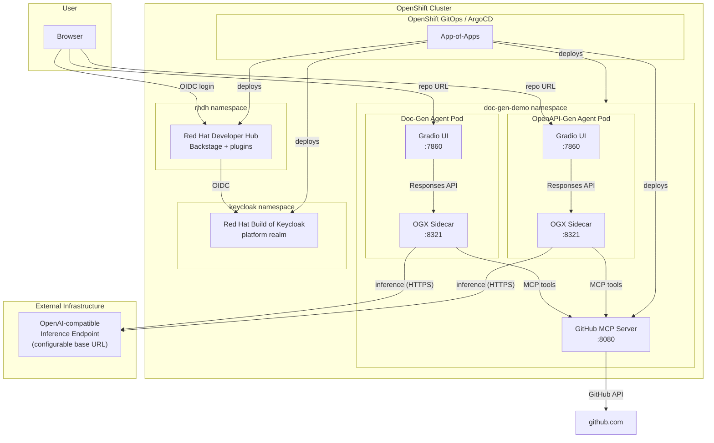
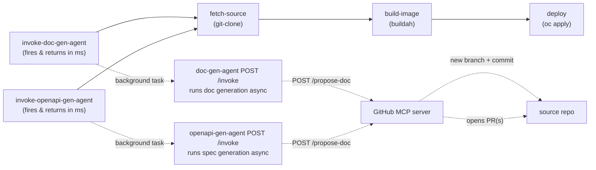

# Agentic Doc Generation — OpenShift Demo

A GitOps-provisioned demo showing two independent AI agents on
**OpenShift** automating repository documentation — a simplified take on
[opendatahub-io/architecture-context](https://github.com/opendatahub-io/architecture-context).

Give either agent a GitHub repository URL. Each explores the repo via a
shared GitHub MCP server, then a model served by **your own external,
OpenAI-compatible endpoint** (no GPU or in-cluster model serving required)
synthesizes its output:

- **doc-gen-agent** — an architecture document with embedded Mermaid (C4)
  diagrams, with an opt-in "Propose as PR" button
- **openapi-gen-agent** — an OpenAPI 3.0.x specification (YAML), for repos
  that look like HTTP API services and don't already ship one, with its
  own opt-in "Propose as PR" button

The two agents are fully independent components: separate pods, separate
UIs/routes, separate budgets, separate PRs. Neither triggers the other.

> **Looking for the original, fully in-cluster design?** The
> [`local-model`](https://github.com/YOUR_ORG/agentic-doc-generation/tree/local-model)
> branch preserves the version where the model is served in-cluster by
> vLLM on OpenShift AI (GPU required).

## How it works



Agent workflow, simplified from architecture-context's six-phase pipeline
down to one agent turn each — run independently by whichever agent the
user invokes:

**doc-gen-agent:**
1. User pastes a GitHub repo URL into the Gradio chat UI
2. Agent calls `get_repo_info` (default branch, language) then
   `get_repo_structure` (filtered file tree) on the GitHub MCP server
3. Agent reads the ~15-20 most architecturally relevant files (README,
   entry points, manifests, Dockerfiles, k8s/CI configs)
4. The configured model (served by an external OpenAI-compatible
   endpoint — your own vLLM/Ollama deployment, OpenAI, an Azure OpenAI
   gateway, etc.) synthesizes a structured architecture document:
   overview, tech stack, components, data flow, external dependencies,
   deployment, security
5. The model generates three Mermaid C4 diagrams (context, container,
   component), embedded directly in the Markdown response
6. Everything streams back into the chat UI

**openapi-gen-agent:**
1. User pastes a GitHub repo URL into its own Gradio chat UI
2. Agent fetches the repo's file tree (zero model budget) and checks
   whether it already ships an OpenAPI/Swagger spec, or looks like an
   HTTP API service without one
3. If so, it calls `get_repo_structure`/`get_file_outline`/`read_file` on
   the GitHub MCP server to find route/controller/handler files and
   request/response models
4. The configured model synthesizes a valid OpenAPI 3.0.x specification
   (YAML) from what it found — never inventing endpoints it has no
   evidence for
5. Everything streams back into its own chat UI

## Prerequisites

- An OpenShift cluster, logged in as `cluster-admin` (`oc login`) —
  no GPU node required
- An **external OpenAI-compatible inference endpoint** reachable from the
  cluster: a base URL (e.g. `https://api.openai.com/v1`, or your own
  vLLM/Ollama/gateway deployment) and, if required, an API key
- `oc` CLI
- This repo pushed to a git remote reachable by the cluster (GitHub,
  GitLab, or an internal git server) — ArgoCD needs to clone it
- (Optional) A `GITHUB_TOKEN` with `public_repo` scope, to raise GitHub
  API rate limits and enable the `search_code` tool. Required (with its
  write access, which `public_repo` already includes) if you want either
  agent's `/invoke` endpoint to propose its generated output back to its
  source repo via PR — see
  [CI/CD pipeline demo](#cicd-pipeline-demo-openshift-pipelines)

## Quick start (GitOps)

```bash
git clone <your-fork-of-this-repo>
cd agentic-doc-generation
./gitops/bootstrap.sh
```

This single command:

1. Installs the OpenShift GitOps operator (if not already present) and
   waits for ArgoCD to come up
2. Points the root ArgoCD Application (`gitops/root-app.yaml`) at your
   repo and applies it
3. ArgoCD then reconciles everything else, in dependency order via
   sync-waves:
   - **Wave 0** — `doc-gen-demo` namespace + GitHub MCP server
   - **Wave 1** — doc-gen-agent and openapi-gen-agent (each its own
     Gradio UI + OGX sidecar pod), applied concurrently — both depend
     only on wave 0's GitHub MCP server Service DNS name
   - **Wave 2** — CI/CD pipeline (Tekton resources)
   - **Wave 3** — Keycloak (RHBK operator + instance) — must be ready
     before RHDH's `configure-rhdh` Job can provision users and the OIDC
     client
   - **Wave 4** — Red Hat Developer Hub (operator + Backstage instance +
     `configure-rhdh` Job at inner wave 18)

The script finishes by printing the ArgoCD UI route. Watch progress with:

```bash
oc get applications -n openshift-gitops -w
```

> **Note:** `bootstrap.sh` edits `gitops/apps/*.yaml` in place to
> substitute your repo's URL (ArgoCD Applications can't template this at
> apply-time). Commit and push that change so ArgoCD's view of the repo
> matches what you applied:
> ```bash
> git add gitops/apps && git commit -m "gitops: point apps at repo" && git push
> ```

Before (or right after) the agents come up, point them at your external
model endpoint — see [Model configuration](#model-configuration) below
(both agents share the same `cluster-config` ConfigMap).

Once `doc-gen-agent` and `openapi-gen-agent` are `Synced`/`Healthy`, get
their UI routes:

```bash
oc get route doc-gen-agent -n doc-gen-demo -o jsonpath='https://{.spec.host}{"\n"}'
oc get route openapi-gen-agent -n doc-gen-demo -o jsonpath='https://{.spec.host}{"\n"}'
```

## Quick start (without GitOps)

For local iteration on the application components only:

```bash
export GITHUB_TOKEN=ghp_xxx                 # optional, raises rate limits + enables search_code + propose-doc
export EXTERNAL_MODEL_API_KEY=sk-xxx        # optional, depends on your endpoint
./build-and-deploy-all.sh
```

Or deploy a single component:

```bash
./build-and-deploy-all.sh github-mcp-server
./build-and-deploy-all.sh doc-gen-agent
./build-and-deploy-all.sh openapi-gen-agent
```

To include the developer portal stack, deploy in this order (Keycloak
**must** be running before Developer Hub's `configure-rhdh` Job can
provision users and the OIDC client):

```bash
bash keycloak/build-and-deploy.sh          # idempotent — skips if already running
bash developer-hub/build-and-deploy.sh     # waits for Keycloak, then brings up RHDH
```

## Demo walkthrough

**doc-gen-agent (architecture docs + diagrams):**
1. Open the doc-gen agent route in a browser
2. Paste a repo URL, e.g. `https://github.com/quarkusio/quarkus-quickstarts`
   (or use one of the example buttons in the UI)
3. Watch the agent:
   - Call `get_repo_info` → learns the default branch and primary language
   - Call `get_repo_structure` → sees the filtered file tree
   - Call `read_file` repeatedly → reads the README, main source files,
     build manifests, Dockerfiles, k8s manifests
   - Stream back a full architecture document with three embedded Mermaid
     C4 diagrams (context, container, component)
4. Try a few different repos to see how the output adapts — a small CLI
   tool produces a much shorter document than a multi-service platform
5. Click **"Propose as PR"** to open a pull request with the generated
   document against the analyzed repo (requires a `GITHUB_TOKEN` with
   write access on the GitHub MCP server)

**openapi-gen-agent (OpenAPI spec):**
1. Open the openapi-gen agent route in a browser (separate Route from
   doc-gen-agent's)
2. Paste a repo URL that exposes an HTTP API, e.g.
   `https://github.com/fastapi/fastapi`
3. Watch the agent check whether a spec is needed, then (if so) explore
   route/controller files and stream back a valid OpenAPI 3.0.x YAML
   document
4. For a repo that already ships a spec, or doesn't look like an API
   service, the agent reports that and stops — no spec is generated
5. Click **"Propose as PR"** to open a pull request with the generated
   spec, independent of any doc-gen-agent PR for the same repo

## Model configuration

Both agents call whatever OpenAI-compatible endpoint you point them
at — your own vLLM/Ollama deployment, a hosted provider like OpenAI, or
an internal gateway. They share the same endpoint configuration, set in
two places:

| File | What to set |
|---|---|
| [`doc-gen-agent/k8s/cluster-config.yaml`](doc-gen-agent/k8s/cluster-config.yaml) | `data.model_base_url` (the endpoint's OpenAI-compatible `/v1` base URL) and `data.model_name` — read by **both** doc-gen-agent and openapi-gen-agent |
| [`doc-gen-agent/ogx/stack_run_config.yaml`](doc-gen-agent/ogx/stack_run_config.yaml) and [`openapi-gen-agent/ogx/stack_run_config.yaml`](openapi-gen-agent/ogx/stack_run_config.yaml) | `registered_resources.models[0].model_id` / `provider_model_id` in **each** file (must match `model_name` above and the identifier your endpoint expects) |

If the endpoint requires an API key, create a Secret (not committed to
git) — both agents' Deployments reference the same Secret name:

```bash
oc create secret generic external-model-credentials \
  --from-literal=api_key=<your-api-key> -n doc-gen-demo
```

Both agents' `k8s/deployment.yaml` read this Secret optionally — leave it
unset for endpoints that don't require auth.

If using GitOps, commit and push the `cluster-config.yaml` /
`stack_run_config.yaml` changes — ArgoCD's `selfHeal` will roll them out
automatically. The Secret itself should never be committed; create it
directly with `oc` as shown above.

## Project structure

```
agentic-doc-generation/
├── gitops/
│   ├── bootstrap.sh                     # Install GitOps operator, apply root app
│   ├── root-app.yaml                    # ArgoCD App-of-Apps
│   ├── openshift-gitops-subscription.yaml
│   └── apps/                            # Child ArgoCD Applications (one per component)
├── github-mcp-server/                   # FastMCP server: get_repo_info, get_repo_structure, read_file, search_code, POST /propose-doc
│   ├── server.py
│   ├── Dockerfile
│   ├── build-and-deploy.sh
│   ├── mcp-catalog.yaml                 # AI Hub catalog entry fragment (template for new components)
│   ├── mcp-catalog-entry.yaml           # Gen AI Playground ConfigMap entry fragment (NOT GitOps-managed)
│   └── k8s/
├── doc-gen-agent/                       # OGX sidecar + Gradio UI — architecture docs & diagrams
│   ├── agent.py                         # OGX Responses API agent, architecture-focused system prompt
│   ├── app.py                           # Gradio chat UI + POST /invoke
│   ├── knowledge.md                     # Documentation style guide injected into the agent prompt
│   ├── k8s/cluster-config.yaml          # External model endpoint config — SHARED with openapi-gen-agent
│   ├── ogx/stack_run_config.yaml        # OGX + external model config
│   ├── build-and-deploy.sh
│   └── k8s/
├── openapi-gen-agent/                   # OGX sidecar + Gradio UI — OpenAPI spec generation (independent)
│   ├── agent.py                         # OGX Responses API agent, OpenAPI-focused system prompt
│   ├── app.py                           # Gradio chat UI + POST /invoke
│   ├── openapi-knowledge.md             # OpenAPI style guide injected into the agent prompt
│   ├── ogx/stack_run_config.yaml        # OGX + external model config
│   ├── build-and-deploy.sh
│   └── k8s/
├── ci-cd-pipeline/                      # OpenShift Pipelines (Tekton) build/deploy demo
│   ├── install-operator.sh              # One-time: installs the OpenShift Pipelines operator
│   ├── build-and-deploy.sh
│   ├── pipelinerun-example.yaml
│   └── k8s/                             # includes tasks/invoke-doc-gen-agent-task.yaml and
│                                         # tasks/invoke-openapi-gen-agent-task.yaml
├── keycloak/                            # Red Hat Build of Keycloak (RHBK) — OIDC identity provider
│   ├── build-and-deploy.sh              # Idempotent deploy: operator + instance + realm shell
│   └── k8s/
│       ├── operator/                    # OperatorGroup, Subscription (stable-v26, Automatic)
│       └── instance/                   # Keycloak CR (dev-file / H2, edge TLS Route)
├── developer-hub/                       # Red Hat Developer Hub (RHDH 1.10) — internal developer portal
│   ├── build-and-deploy.sh              # Deploy operator, instance, run configure-rhdh Job
│   └── k8s/
│       ├── operator/                    # OperatorGroup, Subscription (fast-1.10, Manual), approve-installplan Job
│       ├── instance/                    # ConfigMaps, Secrets, Backstage CR, ConsoleLink, RBAC, rbac-policy.yaml
│       ├── catalog/                     # all.yaml — Backstage entity definitions
│       └── jobs/                        # configure-rhdh.yaml — ArgoCD Sync hook (wave 18)
├── governance-hub-plugin/               # Custom RHDH dynamic plugin — Governance Hub embedded UI
│   └── dist/                            # Built plugin artifact (OCI image published to quay.io/mcombi/rhdh-gov-hub)
├── build-and-deploy-all.sh              # Quick-start (non-GitOps) for app components
├── install-openshift-ai.sh              # One-time: installs OpenShift AI (AI Hub, AI Studio, MLFlow)
├── generate-mcp-catalog-source.sh       # Regenerates mcp-catalog-source.yaml from every */mcp-catalog.yaml
├── register-mcp-catalog.sh              # Registers every */mcp-catalog-entry.yaml in the Gen AI Playground
├── mcp-catalog-source.yaml              # GENERATED — import into the AI Hub MCP Catalog
└── README.md
```

## Developer portal (RHDH + Keycloak)

The stack includes an internal developer portal powered by
**Red Hat Developer Hub (RHDH) 1.10** backed by **Red Hat Build of
Keycloak (RHBK)** for OIDC authentication. Both are optional add-ons —
the AI agents run without them.

### Red Hat Build of Keycloak (`keycloak/`)

| Property | Value |
|---|---|
| Operator | `rhbk-operator`, channel `stable-v26`, **Automatic** install plan |
| Namespace | `keycloak` |
| Instance | Keycloak CR, `dev-file` preset (H2 ephemeral DB, suitable for demo) |
| TLS | Edge-terminated Route |
| SSO URL | `https://sso.apps.ocp.446zs.sandbox2386.opentlc.com` |
| Realm | `platform` (shell CR; users, groups, and OIDC client provisioned by the `configure-rhdh` Job) |
| ArgoCD sync-wave | 3 |

**Provisioned accounts** (all passwords: `password`):

| Username | Group | Portal role |
|---|---|---|
| `admin` | — | RHDH admin |
| `developer` | — | `role:default/developer` |
| `architect` | `architects` | `role:default/architects` |

Deploy:

```bash
bash keycloak/build-and-deploy.sh   # idempotent — skips if already running
```

### Red Hat Developer Hub (`developer-hub/`)

| Property | Value |
|---|---|
| Operator | `rhdh-operator`, channel `fast-1.10`, CSV `rhdh-operator.v1.10.6`, **Manual** install plan |
| Namespace | `rhdh` |
| Backstage CR | `apiVersion: rhdh.redhat.com/v1alpha5` |
| Portal URL | `https://backstage-developer-hub-rhdh.apps.ocp.446zs.sandbox2386.opentlc.com` |
| Auth | OIDC via Keycloak `platform` realm (`signInPage: oidc`) |
| ArgoCD sync-wave | 4 |

**Dynamic plugins enabled:**

- ArgoCD, Kubernetes, RBAC, Global Header (standard RHDH plugins)
- **Governance Hub** — custom plugin loaded from
  `oci://quay.io/mcombi/rhdh-gov-hub:latest`; embeds the Governance Hub
  service as a portal page, visible only to the `architects` group

**RBAC policy** (`developer-hub/k8s/instance/rbac-policy.yaml`):

| Role | Permissions |
|---|---|
| `role:default/developer` | Catalog read, Scaffolder, Kubernetes, ArgoCD |
| `role:default/architects` | All developer permissions + `governance-hub.view` |

**Software catalog** includes: `doc-gen-agent`, `openapi-gen-agent`,
`github-mcp-server`, user and group entities.

**`configure-rhdh` Job** (ArgoCD Sync hook, inner wave 18):
- Auto-discovers live Routes for all components
- Provisions Keycloak users (`admin`, `developer`, `architect`),
  the `architects` group, and the RHDH OIDC client in the `platform` realm
- Patches the `rhdh-secrets` Secret in the `rhdh` namespace
  (ArgoCD `ignoreDifferences` on `/data` prevents drift loops)

> **Dependency:** Developer Hub **requires** Keycloak to be running first.
> The `configure-rhdh` Job reads the `keycloak-initial-admin` Secret
> (created by the RHBK operator) via a cross-namespace RoleBinding to
> obtain an admin token for the Keycloak Admin API.

Deploy (after Keycloak):

```bash
bash developer-hub/build-and-deploy.sh
```

### Governance Hub plugin (`governance-hub-plugin/`)

A custom RHDH dynamic plugin that embeds the Governance Hub service
directly in the developer portal. It is distributed as an OCI image
(`quay.io/mcombi/rhdh-gov-hub:latest`) and loaded by RHDH at startup via
the `dynamicPlugins` section of its ConfigMap. Access is gated by the
`governance-hub.view` RBAC permission, which is granted only to
`role:default/architects` — users in the `architects` Keycloak group.

## CI/CD pipeline demo (OpenShift Pipelines)

[`ci-cd-pipeline/`](ci-cd-pipeline/) adds a self-contained Tekton
`build-deploy-app` Pipeline that demonstrates how an external CI/CD run
can **trigger both agents without blocking** on either: before building
or deploying anything, the pipeline POSTs to doc-gen-agent's and
openapi-gen-agent's `/invoke` endpoints in parallel. Each endpoint
accepts the request (`202 Accepted`) and runs its own generation in the
background — so the pipeline's build/deploy steps proceed immediately
rather than waiting minutes for either agent turn. Once each background
run finishes, that agent proposes its output back to the repo it
analyzed as its own **pull request**: it creates a new branch, commits
the file there, and opens a PR against the base branch via the GitHub
MCP server's `POST /propose-doc` route — neither agent ever writes
directly to an existing branch, so this is safe even against a protected
`main`. The two PRs (if both are opened) are entirely independent —
doc-gen-agent proposes `ARCHITECTURE.md`, openapi-gen-agent proposes
`openapi.yaml` (only if the repo looks like an API without one already).



The pipeline builds the target repo's `Dockerfile` with Buildah, pushes
to the internal OpenShift registry, and deploys a generic
Deployment/Service/Route for it — so it works with **any public repo
that has a Dockerfile**, not just this one.

Prerequisites: the Red Hat **OpenShift Pipelines** operator (Tekton), and
a `GITHUB_TOKEN` (`public_repo` scope is sufficient — it includes write
access) configured on the GitHub MCP server, so it can open PRs against
the repo you point the pipeline at. Without a token, generation still
runs for both agents; each PR step just logs a warning and is skipped.

```bash
./ci-cd-pipeline/install-operator.sh    # one-time: installs the operator, waits for its CRDs
./ci-cd-pipeline/build-and-deploy.sh    # applies the Namespace/RBAC/Tasks/Pipeline
oc create -f ci-cd-pipeline/pipelinerun-example.yaml -n ci-cd-demo
tkn pipelinerun logs -f -n ci-cd-demo
```

Or substitute any public repo/app name directly with the `tkn` CLI:

```bash
tkn pipeline start build-deploy-app -n ci-cd-demo \
  -p repo-url=https://github.com/<org>/<repo> \
  -p app-name=<name> \
  -w name=shared-workspace,claimName=ci-cd-pipeline-workspace \
  --serviceaccount=ci-cd-pipeline-sa
```

If using GitOps, `gitops/apps/ci-cd-pipeline.yaml` registers this
component as an ArgoCD-managed child Application (sync-wave 2) — but the
operator install step above must still be run manually first, since
ArgoCD can't apply `Pipeline`/`Task` resources before their CRDs exist
(the same reason `gitops/bootstrap.sh` installs the OpenShift GitOps
operator itself imperatively).

## OpenShift AI MCP catalog registration (optional)

Every MCP server in this repo (currently just `github-mcp-server`) can be
registered in OpenShift AI through either (or both) of two independent,
repo-root orchestrator scripts that auto-discover every MCP server
component — no need to touch either script when a new one is added:

1. **AI Hub MCP Catalog** — regenerate and import
   [`mcp-catalog-source.yaml`](mcp-catalog-source.yaml):

   ```bash
   ./generate-mcp-catalog-source.sh
   ```

   Then import the resulting file in the dashboard: **Settings > MCP
   resources > MCP catalog sources > Add a source**. No cluster access
   needed for this one — it's a plain file upload. `mcp-catalog-source.yaml`
   is a **generated** file (don't hand-edit it); it's produced by
   concatenating every `*/mcp-catalog.yaml` fragment in the repo into one
   `mcp_servers:` list, matching the format OpenShift AI's catalog import
   expects.

2. **Gen AI Playground tool list** — run, with `oc` access to the
   cluster:

   ```bash
   ./register-mcp-catalog.sh
   ```

   This merges every `*/mcp-catalog-entry.yaml` fragment's single key
   into the platform-wide `gen-ai-aa-mcp-servers` ConfigMap in the
   `redhat-ods-applications` namespace (RHOAI 3.0+), pointing at each
   component's already-running Service — it doesn't deploy a second copy
   of anything. Each fragment is applied as its own JSON Merge Patch, so
   it's safe to run on a cluster where other MCP servers (from this repo
   or elsewhere) are already registered.

**To register a new MCP server you add to this repo:** copy
[`github-mcp-server/mcp-catalog.yaml`](github-mcp-server/mcp-catalog.yaml)
and
[`github-mcp-server/mcp-catalog-entry.yaml`](github-mcp-server/mcp-catalog-entry.yaml)
into the new component's own directory as templates, fill in its name,
description, tools, and in-cluster URL (and give the ConfigMap entry's
key a unique name), then re-run both scripts above. That's the entire
integration surface — neither script, nor `mcp-catalog-source.yaml`,
needs to change by hand.

Both fragment files are deliberately kept out of each component's
`k8s/` directory (and therefore out of GitOps/ArgoCD): the resources
they target — the AI Hub catalog import and the shared
`gen-ai-aa-mcp-servers` ConfigMap — are cluster-admin-owned, cross
component/namespace state, so letting ArgoCD "own" and prune a shared
ConfigMap (most `k8s/` Applications in this repo have `prune: true`)
would risk deleting every other registered MCP server the moment one
component's fragment was ever removed from git — see the comment at the
top of
[`github-mcp-server/mcp-catalog-entry.yaml`](github-mcp-server/mcp-catalog-entry.yaml).

Prerequisites: OpenShift AI installed with AI Hub enabled (see
[`install-openshift-ai.sh`](install-openshift-ai.sh), which also enables
the `mcpCatalog`/`mcpRegistry` dashboard feature flags) and the MCP
server(s) already deployed in `doc-gen-demo`.

## Known limitations

- This demo analyzes **public** GitHub repos only (the GitHub MCP server
  uses unauthenticated or token-based REST calls, no OAuth flow).
- `search_code` requires a `GITHUB_TOKEN` (GitHub's code search API does
  not support unauthenticated requests).
- Proposing generated output back to its source repo (via `/invoke` →
  `POST /propose-doc`, or via each agent's opt-in "Propose as PR" button)
  requires a `GITHUB_TOKEN` with write access. It always creates a fresh
  branch (`agentic-docs/<random>` for doc-gen-agent, `agentic-openapi/<random>`
  for openapi-gen-agent) off the base branch (the repo's default branch,
  or `ARCHITECTURE_DOC_BASE_BRANCH`/`OPENAPI_SPEC_BASE_BRANCH` if set) and
  opens a PR into it — neither agent ever pushes directly to an existing
  branch, so this is safe against protected branches, but someone still
  has to review and merge the PR. **Neither agent ever opens a PR
  automatically from its chat UI** — a PR is only ever opened via
  `/invoke` (the CI/CD trigger path) or an explicit "Propose as PR" click.
- Each agent reads file contents one at a time; very large monorepos will
  hit the `MAX_INFER_ITERS` / token-budget guardrails in
  [`doc-gen-agent/agent.py`](doc-gen-agent/agent.py) and
  [`openapi-gen-agent/agent.py`](openapi-gen-agent/agent.py) and produce a
  partial-but-useful (or, for openapi-gen-agent, no) result rather than
  exhaustive coverage — this mirrors the token-budget tuning notes in the
  reference ocp-troubleshooter-demo.
- openapi-gen-agent's file-tree heuristic (`detect_needs_openapi`) is a
  cheap pre-filter, not authoritative — the agent's own system prompt
  re-confirms and bails out with `NOT_AN_API` if it disagrees, so a wrong
  heuristic trigger costs one extra bounded agent run, never a bogus PR.
- Inference quality and latency depend entirely on the external endpoint
  you configure — this repo does not provision or manage that endpoint.
